# 🧠 Deep Learning Project 2
## Adult Income Classification Using Artificial Neural Networks (ANN)

An end-to-end Deep Learning project that uses an Artificial Neural Network (ANN) to predict whether a person's annual income is **above or below $50K** based on demographic and employment-related information.

The project explores data preprocessing, Exploratory Data Analysis (EDA), neural network architecture, activation functions, weight initialization, loss functions, Batch Normalization, optimizers, and model evaluation.

---

## 📌 Problem Statement

The objective of this project is to build a binary classification model that predicts an individual's income category using the Adult Income dataset.

The target variable contains two classes:

- `0` — Income <=50K
- `1` — Income >50K

Since the dataset contains more observations from the <=50K class, accuracy alone is not sufficient for evaluating the model. Therefore, Precision, Recall, F1-Score, ROC-AUC, and Confusion Matrix are also used.

## 🎯 Project Objectives

- Load, inspect, and clean the Adult Income dataset.
- Handle missing values and prepare the target variable.
- Perform Exploratory Data Analysis using visualizations.
- Encode categorical features and scale numerical features.
- Build a baseline Artificial Neural Network.
- Compare ReLU, Tanh, Sigmoid, and ELU activation functions.
- Experiment with different weight initialization methods.
- Compare BCE, MSE, Weighted BCE, and Focal Loss.
- Understand and implement Batch Normalization.
- Compare different optimizers and learning rates.
- Build and evaluate a final combined ANN model.

## 📂 Project Structure

```text
Deep-Learning-PR2-Adult-Income-Classification/
│
├── adult.csv
├── DL_PR2.ipynb
├── DL_PR2.html
├── requirements.txt
├── README.md
│
└── Project_Graphs/
    ├── Task_1_5a_age_by_income.png
    ├── Task_1_5b_hours_boxplot.png
    ├── Task_1_5c_education_countplot.png
    ├── Task_1_5d_correlation_heatmap.png
    ├── Task_2_3_baseline_training_curves.png
    ├── Task_2_4_baseline_confusion_matrix.png
    ├── Task_3_2_activation_comparison.png
    ├── Task_3_4_sigmoid_gradient_magnitude.png
    ├── Task_4_3_initializer_convergence.png
    ├── Task_4_4_zero_initialization_failure.png
    ├── Task_4_5_weight_distributions.png
    ├── Task_5_2_mse_vs_bce_validation_f1.png
    ├── Task_5_3_weighted_bce_metrics.png
    ├── Task_5_4_loss_function_comparison.png
    ├── Task_6_3_batchnorm_vs_baseline.png
    ├── Task_6_4_batchnorm_position.png
    ├── Task_6_5_batchnorm_gamma_beta.png
    ├── Task_7_2_optimizer_convergence.png
    ├── Task_7_4_learning_rate_sensitivity.png
    └── Task_7_6_roc_curve_comparison.png
```

## 🛠️ Technologies & Libraries

| Technology | Purpose |
|---|---|
| Python | Programming language |
| Pandas | Data manipulation |
| NumPy | Numerical operations |
| Matplotlib | Data visualization |
| Seaborn | Statistical visualization |
| Scikit-learn | Preprocessing and evaluation |
| TensorFlow | Deep Learning framework |
| Keras | ANN model development |
| Jupyter Notebook | Interactive development |

---

# 📊 Task 1 — Data Loading, Cleaning & Exploratory Data Analysis

## Task 1.1 — Load and Inspect the Dataset

First, load the Adult Income dataset and inspect its structure, data types, and initial records.

### Python Code

```python
import pandas as pd
import numpy as np
import matplotlib.pyplot as plt
import seaborn as sns

df = pd.read_csv("adult.csv")

print("Dataset Shape:", df.shape)

print("\nDataset Information:")
print(df.info())

print("\nFirst Five Rows:")
display(df.head())
```

### Output

- Initial dataset shape: **48,842 rows × 15 columns**
- The dataset contains numerical and categorical features.
- The target column is `income`.

🎯 **Insight:** Initial inspection helps understand the dataset structure, identify feature types, and prepare for data cleaning.

## Task 1.2 — Handle Missing Values

Missing values can affect model training and produce unreliable results. In this dataset, missing entries are also represented by the `?` symbol.

### Python Code

```python
# Replace '?' with NaN
df.replace("?", np.nan, inplace=True)

# Check missing values
print("Missing Values:")
print(df.isnull().sum())

# Remove rows containing missing values
df.dropna(inplace=True)

print("\nShape After Cleaning:", df.shape)

# Verify missing values
print("\nRemaining Missing Values:")
print(df.isnull().sum().sum())
```

🎯 **Insight:** Replacing `?` with `NaN` makes missing values detectable by Pandas. Removing incomplete rows produces a dataset without missing entries for the subsequent experiments.

## Task 1.3 — Remove Unnecessary Columns

The `fnlwgt` and `education` columns are removed according to the project requirements. The `educational-num` feature is retained as a numerical representation of education level.

### Python Code

```python
print("Columns Before Dropping:")
print(df.columns.tolist())

df.drop(
    columns=["fnlwgt", "education"],
    inplace=True
)

print("\nColumns After Dropping:")
print(df.columns.tolist())
```

🎯 **Insight:** Removing the specified columns simplifies the feature set and avoids retaining both education representations.

## Task 1.4 — Encode the Target Variable

The income column is converted into numerical binary labels.

- `<=50K` becomes `0`
- `>50K` becomes `1`

### Python Code

```python
df["income"] = df["income"].map({
    "<=50K": 0,
    ">50K": 1
})

print(df["income"].value_counts())

print("\nUnique Target Values:")
print(sorted(df["income"].unique()))
```

🎯 **Insight:** Binary encoding converts the target into a numerical format suitable for a neural network with a single sigmoid output neuron.

## Task 1.5 — Exploratory Data Analysis (EDA)

EDA helps identify patterns, distributions, relationships, and differences between income groups.

### A. Age Distribution by Income

**Why this graph?**

A histogram helps understand how age is distributed across the two income categories.

```python
plt.figure(figsize=(9, 5))

sns.histplot(
    data=df,
    x="age",
    hue="income",
    bins=30,
    kde=True
)

plt.title("Age Distribution by Income")
plt.xlabel("Age")
plt.ylabel("Count")

plt.tight_layout()
plt.show()
```

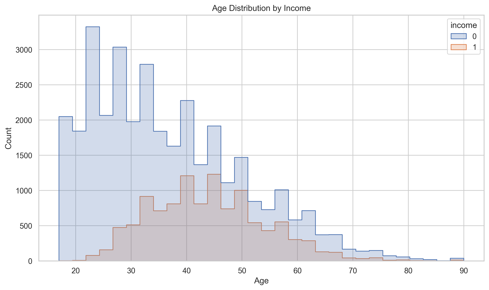

🎯 **Insight:** The distribution helps compare the age patterns of individuals earning <=50K and >50K.

### B. Weekly Working Hours — Boxplot

**Why this graph?**

A boxplot compares the median, spread, and potential outliers in weekly working hours for both income groups.

```python
plt.figure(figsize=(8, 5))

sns.boxplot(
    data=df,
    x="income",
    y="hours-per-week"
)

plt.title("Weekly Working Hours by Income")
plt.xlabel("Income Category")
plt.ylabel("Hours Per Week")

plt.tight_layout()
plt.show()
```

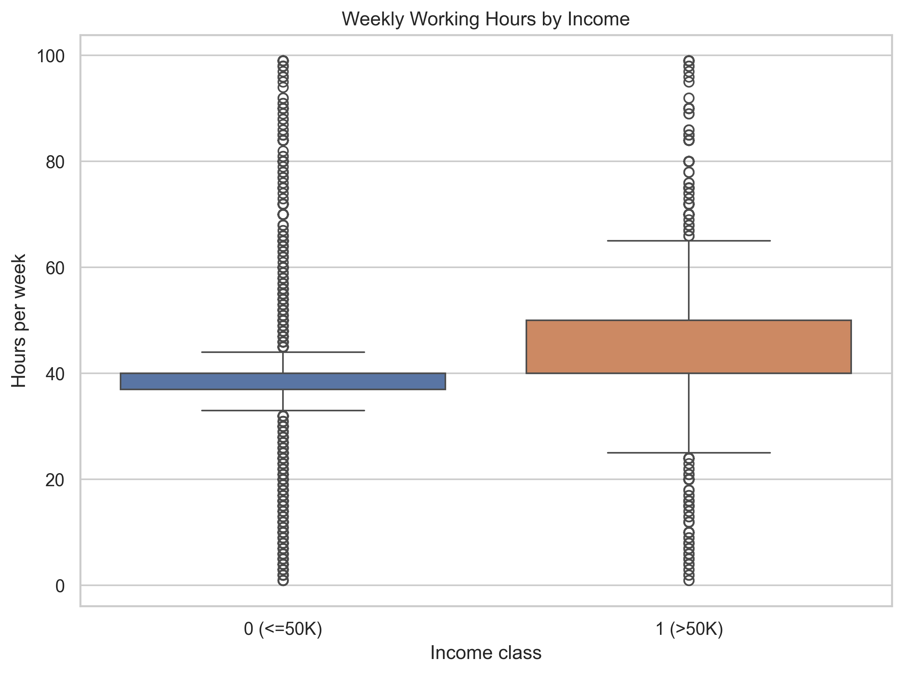

🎯 **Insight:** The boxplot makes it easier to compare typical working hours and variation across income categories.

### C. Education Level Countplot

**Why this graph?**

A countplot displays the frequency of different education levels.

```python
plt.figure(figsize=(12, 6))

sns.countplot(
    data=df,
    x="educational-num",
    hue="income"
)

plt.title("Education Level by Income")
plt.xlabel("Educational Number")
plt.ylabel("Count")

plt.tight_layout()
plt.show()
```

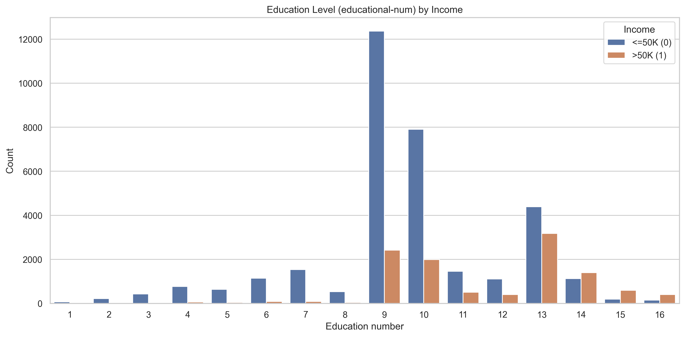

🎯 **Insight:** This visualization helps examine how education-level frequencies differ between the income categories.

### D. Correlation Heatmap

**Why this graph?**

A correlation heatmap shows the strength and direction of relationships between numerical features.

```python
numeric_df = df.select_dtypes(include=np.number)

plt.figure(figsize=(11, 8))

sns.heatmap(
    numeric_df.corr(),
    annot=True,
    cmap="coolwarm",
    center=0,
    fmt=".2f"
)

plt.title("Correlation Heatmap")

plt.tight_layout()
plt.show()
```

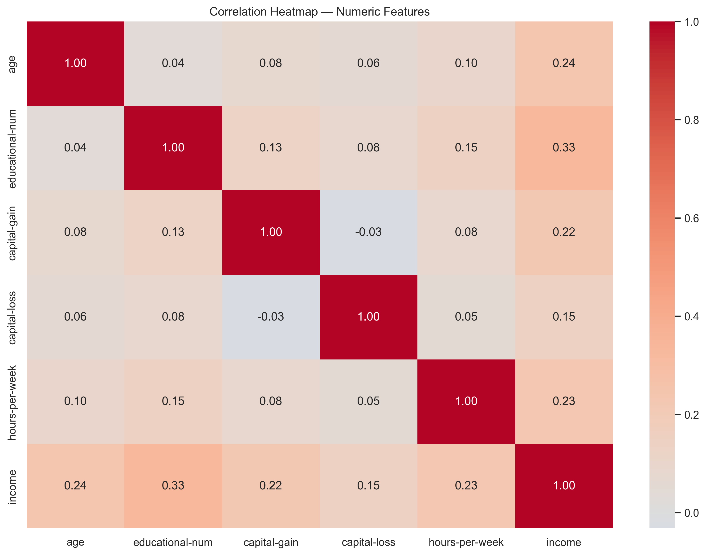

🎯 **Insight:** Correlation analysis helps identify relationships among numerical variables. Correlation does not necessarily imply causation.

## Task 1.6 — Feature Encoding, Scaling & Train-Test Split

Categorical features are converted into numerical columns using One-Hot Encoding. Numerical features are standardized using `StandardScaler`.

The scaler is fitted only on the training data to avoid data leakage.

### Python Code

```python
from sklearn.model_selection import train_test_split
from sklearn.preprocessing import StandardScaler

# Separate features and target
X = df.drop("income", axis=1)
y = df["income"]

# One-Hot Encoding
X = pd.get_dummies(
    X,
    drop_first=True,
    dtype=int
)

# Stratified train-test split
X_train, X_test, y_train, y_test = train_test_split(
    X,
    y,
    test_size=0.20,
    random_state=42,
    stratify=y
)

# Scale features
scaler = StandardScaler()

X_train = pd.DataFrame(
    scaler.fit_transform(X_train),
    columns=X.columns,
    index=X_train.index
)

X_test = pd.DataFrame(
    scaler.transform(X_test),
    columns=X.columns,
    index=X_test.index
)

print("Training Shape:", X_train.shape)
print("Testing Shape:", X_test.shape)
```

🎯 **Insight:** Stratified splitting preserves the class proportions in training and testing data. Fitting the scaler only on training data prevents information from the test set leaking into training.

---

# 🧠 Task 2 — Baseline Artificial Neural Network

## Task 2.1 — Understanding the ANN Architecture

The baseline model uses a Multi-Layer Perceptron (MLP) with:

```text
Input Layer
     |
Dense Layer — 128 Neurons — ReLU
     |
Dense Layer — 64 Neurons — ReLU
     |
Output Layer — 1 Neuron — Sigmoid
     |
Income Prediction
```

- Hidden layer 1: 128 neurons
- Hidden layer 2: 64 neurons
- Output layer: 1 neuron
- Activation: ReLU in hidden layers and Sigmoid in output layer
- Optimizer: Adam
- Loss: Binary Cross-Entropy

## Task 2.2 — Build a Reusable ANN Function

A reusable function allows different model experiments to use a consistent architecture.

### Python Code

```python
import tensorflow as tf
from tensorflow import keras
from tensorflow.keras import layers

def build_ann(
    input_dim,
    hidden_units=(128, 64),
    activation="relu",
    initializer="glorot_uniform",
    use_batch_norm=False,
    optimizer="adam",
    loss="binary_crossentropy"
):

    model = keras.Sequential()

    model.add(
        layers.Input(shape=(input_dim,))
    )

    for units in hidden_units:

        if use_batch_norm:
            model.add(
                layers.Dense(
                    units,
                    kernel_initializer=initializer
                )
            )

            model.add(layers.BatchNormalization())
            model.add(layers.Activation(activation))

        else:
            model.add(
                layers.Dense(
                    units,
                    activation=activation,
                    kernel_initializer=initializer
                )
            )

    model.add(
        layers.Dense(1, activation="sigmoid")
    )

    model.compile(
        optimizer=optimizer,
        loss=loss,
        metrics=["accuracy"]
    )

    return model
```

🎯 **Insight:** A reusable ANN function makes it easier to compare activation functions, initializers, losses, and normalization techniques without repeatedly writing the entire architecture.

## Task 2.3 — Train the Baseline ANN

```python
input_dim = X_train.shape[1]

model_base = build_ann(
    input_dim=input_dim,
    hidden_units=(128, 64),
    activation="relu",
    initializer="glorot_uniform",
    use_batch_norm=False,
    optimizer="adam",
    loss="binary_crossentropy"
)

history_base = model_base.fit(
    X_train,
    y_train,
    epochs=50,
    batch_size=64,
    validation_split=0.1,
    verbose=1
)
```

🎯 **Insight:** The baseline model provides a reference point for comparing all subsequent experiments.

## Task 2.4 — Evaluate the Baseline Model

The model is evaluated using multiple classification metrics.

```python
from sklearn.metrics import (
    accuracy_score,
    precision_score,
    recall_score,
    f1_score,
    roc_auc_score,
    confusion_matrix,
    classification_report
)

y_prob = model_base.predict(
    X_test,
    verbose=0
).ravel()

y_pred = (y_prob >= 0.5).astype(int)

print("Accuracy:", accuracy_score(y_test, y_pred))
print("Precision:", precision_score(y_test, y_pred))
print("Recall:", recall_score(y_test, y_pred))
print("F1-Score:", f1_score(y_test, y_pred))
print("ROC-AUC:", roc_auc_score(y_test, y_prob))

print("\nClassification Report:")
print(classification_report(y_test, y_pred))
```

### Baseline Training Curves

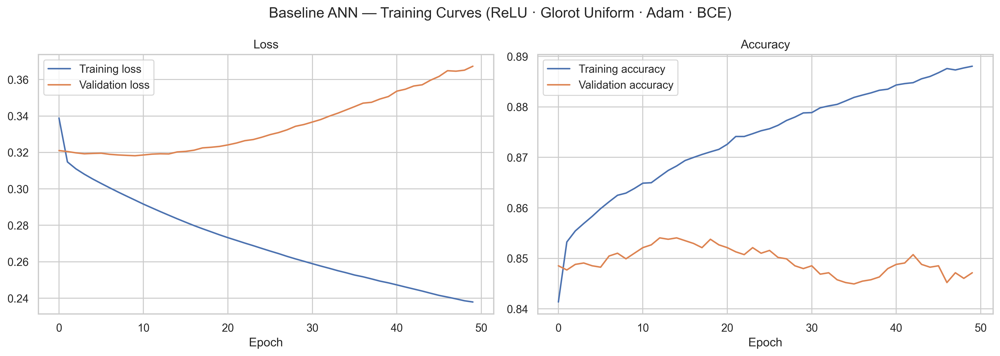

**Why this graph?**

Training and validation curves help identify learning behaviour, convergence, and possible overfitting.

🎯 **Insight:** Comparing training and validation performance helps determine whether the ANN is learning patterns that generalize to unseen observations.

### Baseline Confusion Matrix

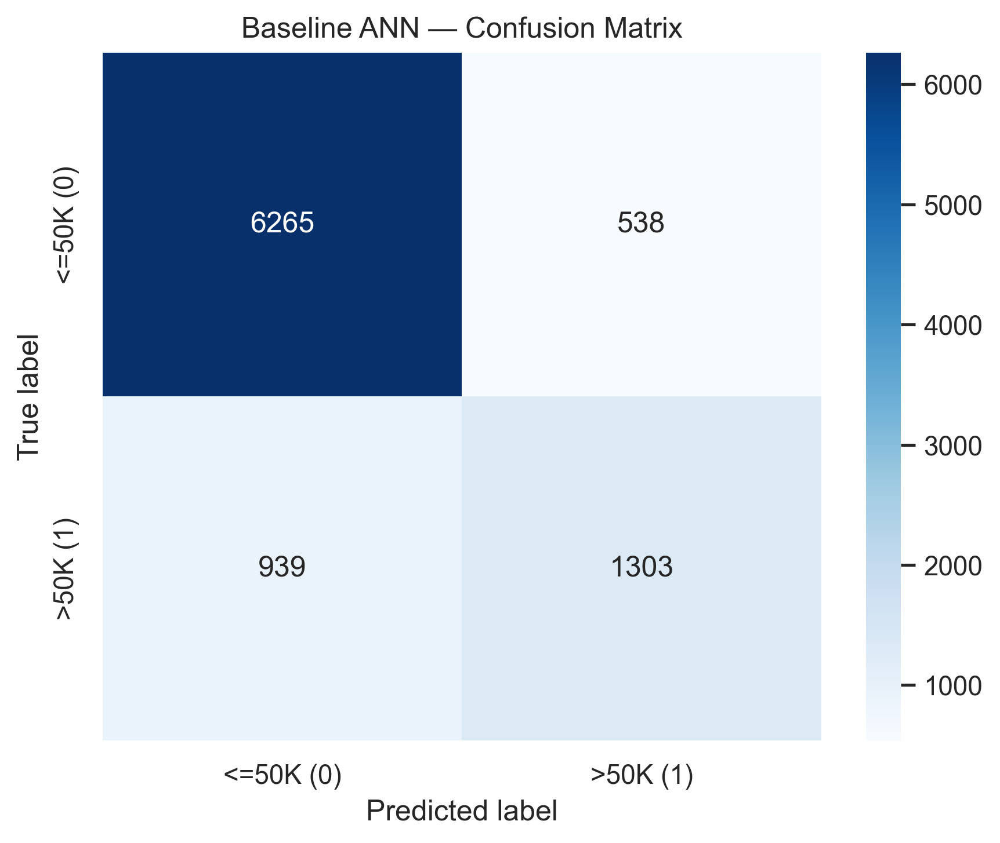

🎯 **Insight:** The confusion matrix shows correct and incorrect predictions for both income categories. It is particularly useful for examining mistakes on the minority >50K class.

---

# ⚡ Task 3 — Activation Function Experiments

## Task 3.1 — Compare Different Activation Functions

The following activation functions are compared:

- ReLU
- Tanh
- Sigmoid
- ELU

All models use the same baseline architecture and training configuration.

### Python Code

```python
activation_functions = [
    "relu",
    "tanh",
    "sigmoid",
    "elu"
]

activation_models = {}
activation_histories = {}

for activation_name in activation_functions:

    keras.utils.set_random_seed(42)

    model = build_ann(
        input_dim=X_train.shape[1],
        hidden_units=(128, 64),
        activation=activation_name,
        initializer="glorot_uniform",
        use_batch_norm=False,
        optimizer="adam",
        loss="binary_crossentropy"
    )

    history = model.fit(
        X_train,
        y_train,
        epochs=50,
        batch_size=64,
        validation_split=0.1,
        verbose=0
    )

    activation_models[activation_name] = model
    activation_histories[activation_name] = history

print("All activation experiments completed.")
```

## Task 3.2 — Activation Function Comparison

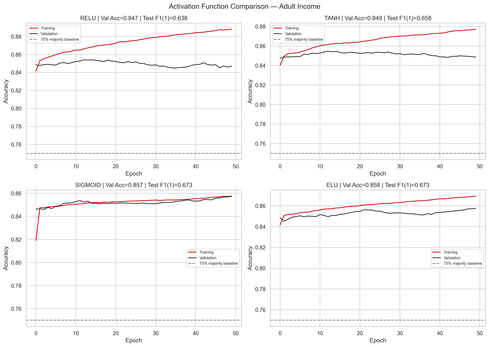

**Why this graph?**

The four-panel comparison displays validation accuracy for each activation function. It also includes the 75% majority-class baseline for reference.

🎯 **Insight:** Validation accuracy and class-1 F1 should both be considered. A higher accuracy does not automatically mean better detection of individuals earning >50K.

## Task 3.3 — ReLU Dead Neuron Analysis

ReLU outputs zero for negative inputs. If a neuron consistently produces zero activation, it may become inactive.

### Python Code

```python
relu_model = activation_models["relu"]

input_dim = X_train.shape[1]
relu_model.build((None, input_dim))

first_dense = next(
    layer for layer in relu_model.layers
    if isinstance(layer, layers.Dense)
)

input_tensor = keras.Input(shape=(input_dim,))

intermediate_model = keras.Model(
    inputs=input_tensor,
    outputs=first_dense(input_tensor)
)

X_sample = X_test.iloc[:500]

activation_values = intermediate_model.predict(
    X_sample,
    verbose=0
)

dead_fraction = np.mean(activation_values == 0)

mean_activation = activation_values.mean(axis=0)

dead_neuron_count = np.sum(
    np.all(activation_values == 0, axis=0)
)

print("Zero Activation Fraction:", dead_fraction)
print("Dead Neuron Count:", dead_neuron_count)
```

🎯 **Insight:** This experiment checks how frequently the first hidden layer produces zero activations and whether any neuron remains inactive across the sampled observations.

## Task 3.4 — Sigmoid Gradient Flow

Sigmoid can suffer from vanishing gradients when activations enter saturated regions.

The experiment uses TensorFlow GradientTape to examine gradient magnitudes across hidden layers.

🎯 **Insight:** Very small gradients in earlier layers can make learning slower because weight updates become less effective.

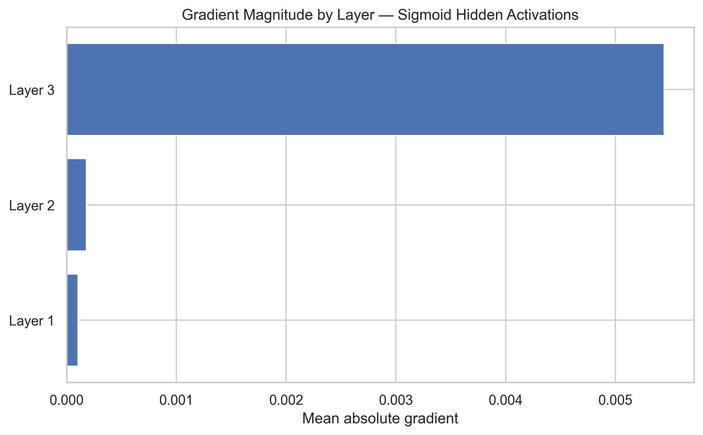

## Task 3.5 — Activation Function Summary

| Activation | Output Range | Main Characteristic |
|---|---|---|
| ReLU | 0 to infinity | Efficient and commonly used in hidden layers |
| Tanh | -1 to 1 | Zero-centred output |
| Sigmoid | 0 to 1 | Can suffer from vanishing gradients |
| ELU | -1 to infinity | Allows negative outputs |

**Conclusion:** The best activation function should be selected using the actual validation and test results rather than theoretical expectations alone.

---

# ⚙️ Task 4 — Weight Initialization Techniques

## Task 4.1 — Compare Five Initializers

The experiment compares:

1. Glorot Uniform
2. Glorot Normal
3. He Uniform
4. He Normal
5. Zeros

### Python Code

```python
initializers = [
    "glorot_uniform",
    "glorot_normal",
    "he_uniform",
    "he_normal",
    "zeros"
]

initializer_models = {}
initializer_histories = {}

for initializer_name in initializers:

    keras.utils.set_random_seed(42)

    model = build_ann(
        input_dim=X_train.shape[1],
        hidden_units=(128, 64),
        activation="relu",
        initializer=initializer_name,
        use_batch_norm=False,
        optimizer="adam",
        loss="binary_crossentropy"
    )

    history = model.fit(
        X_train,
        y_train,
        epochs=50,
        batch_size=64,
        validation_split=0.1,
        verbose=0
    )

    initializer_models[initializer_name] = model
    initializer_histories[initializer_name] = history

print("All five initializer models completed.")
```

🎯 **Insight:** Weight initialization affects the starting point of training and can influence convergence speed and model learning.

## Task 4.2 — Why Weight Initialization Matters

Neural networks need suitable initial weights to maintain effective signal and gradient flow through layers.

- Glorot initialization is commonly used with tanh-like activations.
- He initialization is designed for ReLU-like activations.
- Zero initialization gives identical starting weights and can prevent hidden neurons from learning different features.

## Task 4.3 — Convergence Speed Comparison

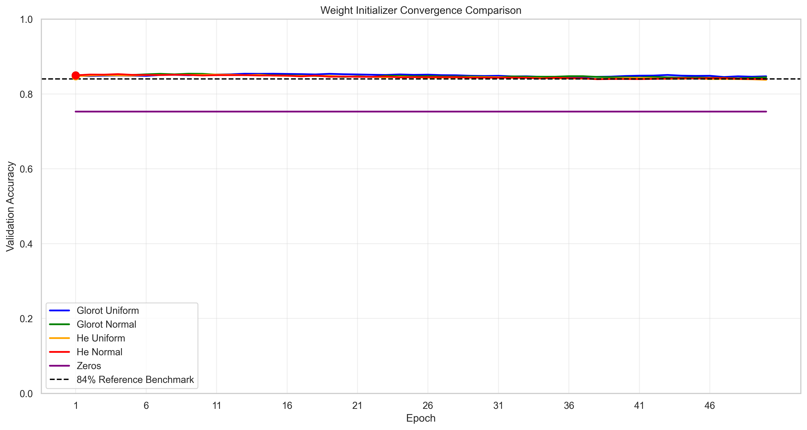

**Why this graph?**

It compares validation accuracy across epochs and helps examine how quickly different initializers approach the specified accuracy benchmarks.

🎯 **Insight:** The convergence graph helps identify which initialization method learns effectively during training. The best choice should be based on measured results.

## Task 4.4 — Zero Initialization Failure

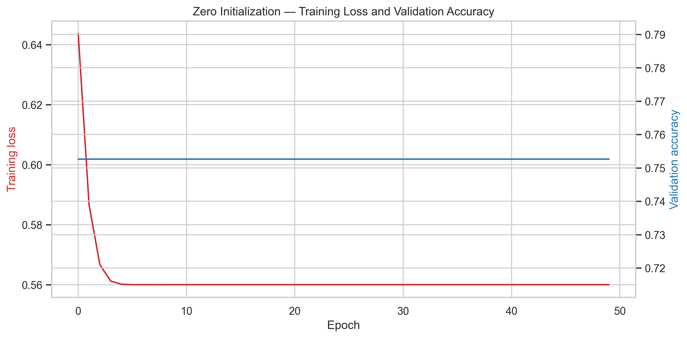

🎯 **Insight:** When all weights start at zero, neurons in the same layer receive identical updates. This symmetry prevents them from learning diverse representations.

## Task 4.5 — Weight Distribution Analysis

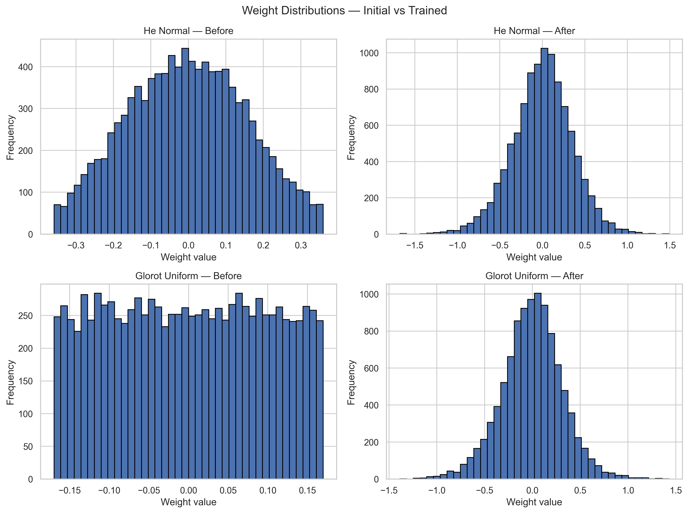

🎯 **Insight:** Weight histograms help visualize how initialization methods distribute starting weights and how training changes those distributions.

---

# 📉 Task 5 — Loss Function Comparison

## Task 5.1 — Binary Cross-Entropy

Binary Cross-Entropy is commonly used for binary classification with a sigmoid output.

Mathematical formula:

\[
L = -[y\log(p)+(1-y)\log(1-p)]
\]

Where:

- `y` is the actual class.
- `p` is the predicted probability.

### Python Code

```python
model_bce = build_ann(
    input_dim=X_train.shape[1],
    hidden_units=(128, 64),
    activation="relu",
    initializer="he_normal",
    optimizer="adam",
    loss="binary_crossentropy"
)
```

🎯 **Insight:** BCE penalizes incorrect probability predictions and is an appropriate baseline loss for binary classification.

## Task 5.2 — Mean Squared Error vs Binary Cross-Entropy

MSE is tested as an alternative classification loss.

```python
model_mse = build_ann(
    input_dim=X_train.shape[1],
    hidden_units=(128, 64),
    activation="relu",
    initializer="he_normal",
    optimizer="adam",
    loss="mse"
)

history_mse = model_mse.fit(
    X_train,
    y_train,
    epochs=50,
    batch_size=64,
    validation_split=0.1,
    verbose=0
)
```

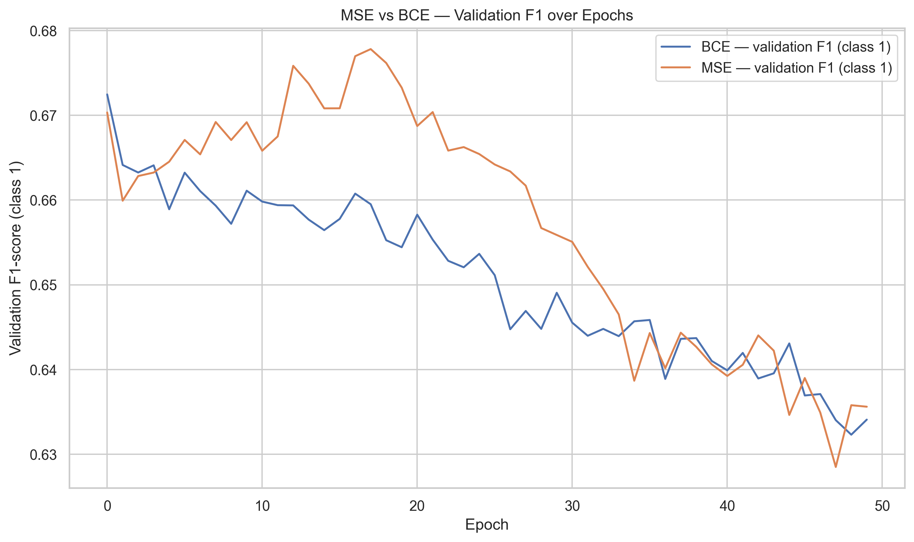

🎯 **Insight:** Comparing validation F1 across epochs helps determine which loss function performs better for identifying the >50K income class.

## Task 5.3 — Weighted Binary Cross-Entropy

Class weights give additional importance to the minority class during training.

### Python Code

```python
from sklearn.utils.class_weight import compute_class_weight

classes = np.unique(y_train)

weights = compute_class_weight(
    class_weight="balanced",
    classes=classes,
    y=y_train
)

class_weight_dict = dict(
    zip(classes, weights)
)

print("Class Weights:", class_weight_dict)
```

The class weights are passed during model training:

```python
history_wbce = model_wbce.fit(
    X_train,
    y_train,
    epochs=50,
    batch_size=64,
    validation_split=0.1,
    class_weight=class_weight_dict,
    verbose=0
)
```

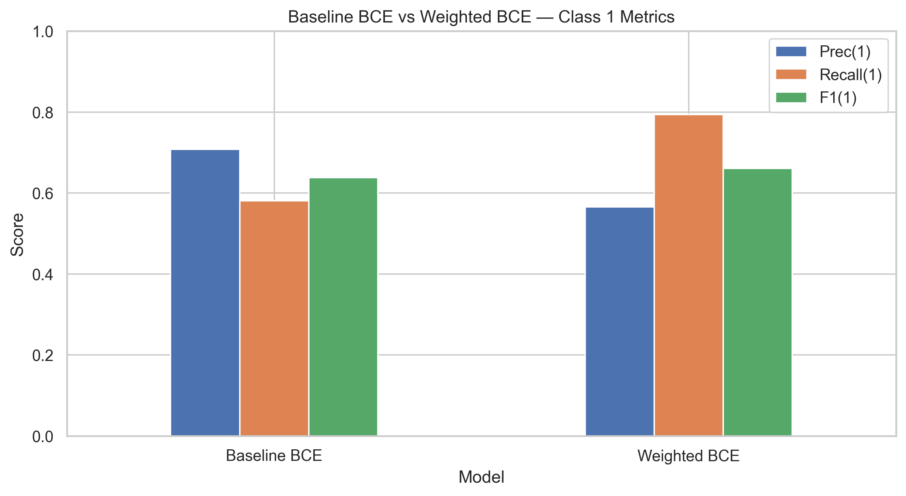

🎯 **Insight:** Weighted BCE can improve minority-class recall by assigning greater importance to the less frequent class. However, precision and F1 must also be checked.

## Task 5.4 — Focal Loss

Focal Loss reduces the contribution of easy examples and focuses more on difficult examples.

The experiment uses:

- Gamma = 2.0
- Alpha = 0.25

### Python Code

```python
def focal_loss(gamma=2.0, alpha=0.25):

    def loss(y_true, y_pred):

        y_true = tf.cast(y_true, tf.float32)

        epsilon = keras.backend.epsilon()

        y_pred = tf.clip_by_value(
            y_pred,
            epsilon,
            1.0 - epsilon
        )

        cross_entropy = -(
            y_true * tf.math.log(y_pred)
            + (1 - y_true) * tf.math.log(1 - y_pred)
        )

        p_t = (
            y_true * y_pred
            + (1 - y_true) * (1 - y_pred)
        )

        alpha_factor = (
            y_true * alpha
            + (1 - y_true) * (1 - alpha)
        )

        modulating_factor = tf.pow(
            1.0 - p_t,
            gamma
        )

        return tf.reduce_mean(
            alpha_factor * modulating_factor * cross_entropy
        )

    return loss
```

🎯 **Insight:** Focal Loss is designed to emphasize difficult predictions. Its effectiveness must be judged using class-specific metrics rather than assuming it will always outperform BCE.

## Task 5.5 — Loss Function Comparison

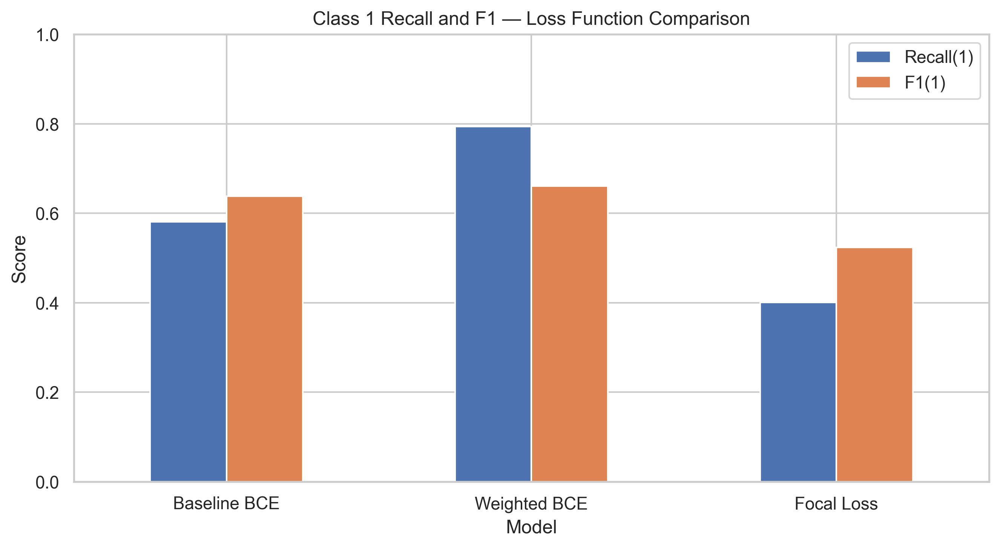

| Loss Function | Purpose |
|---|---|
| Binary Cross-Entropy | Standard binary classification loss |
| MSE | Alternative loss experiment |
| Weighted BCE | Gives more importance to the minority class |
| Focal Loss | Focuses on difficult examples |

**Conclusion:** The preferred loss function depends on the measured class-1 precision, recall, and F1-score.

---

# 🔄 Task 6 — Batch Normalization

## Task 6.1 — Build ANN with Batch Normalization

Batch Normalization normalizes layer inputs during training and learns scale and shift parameters.

The architecture is:

```text
Input
  |
Dense(128) — He Normal
  |
Batch Normalization
  |
ReLU
  |
Dense(64) — He Normal
  |
Batch Normalization
  |
ReLU
  |
Dense(1) — Sigmoid
```

### Python Code

```python
model_bn = build_ann(
    input_dim=X_train.shape[1],
    hidden_units=(128, 64),
    activation="relu",
    initializer="he_normal",
    use_batch_norm=True,
    optimizer="adam",
    loss="binary_crossentropy"
)

history_bn = model_bn.fit(
    X_train,
    y_train,
    epochs=50,
    batch_size=64,
    validation_split=0.1,
    verbose=0
)
```

🎯 **Insight:** Batch Normalization can influence training stability and convergence. Its actual benefit should be measured against the baseline model.

## Task 6.2 — Batch Normalization vs Baseline

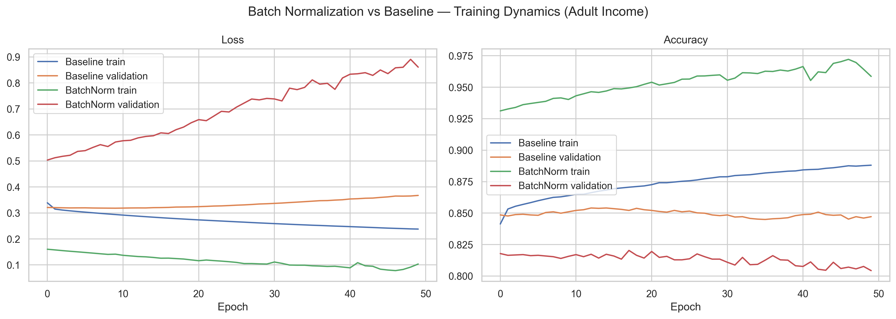

🎯 **Insight:** The training curves compare the learning behaviour of the baseline ANN and the Batch Normalization model.

## Task 6.3 — Batch Normalization Position

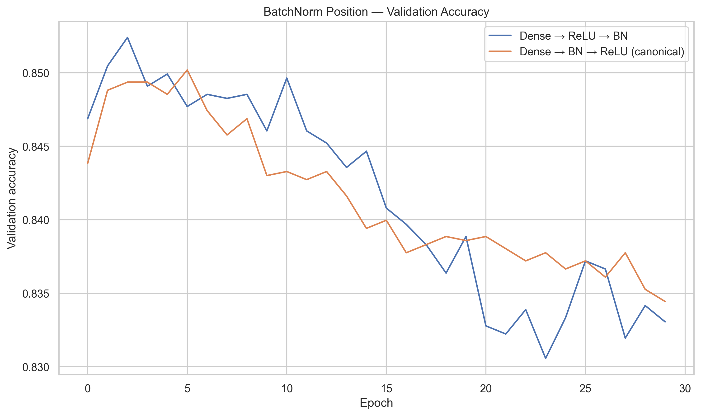

Two layer orders are compared:

- Dense → ReLU → Batch Normalization
- Dense → Batch Normalization → ReLU

🎯 **Insight:** The experiment demonstrates how placing Batch Normalization before or after the activation function can affect training behaviour.

## Task 6.4 — Gamma and Beta Parameters

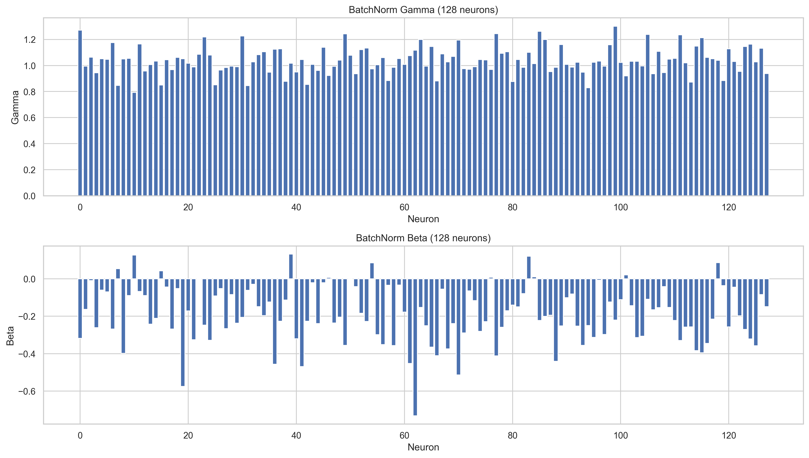

- Gamma controls the learned scale.
- Beta controls the learned shift.

🎯 **Insight:** Gamma and beta are trainable parameters that allow Batch Normalization to learn an appropriate transformation of normalized activations.

---

# 🚀 Task 7 — Optimizer Comparison & Final Model

## Task 7.1 — Compare Different Optimizers

The following optimizers are tested:

1. Vanilla SGD
2. SGD with Momentum
3. RMSprop
4. Adam
5. Adam with explicitly specified parameters

### Python Code

```python
optimizer_configs = {
    "SGD": keras.optimizers.SGD(
        learning_rate=0.01
    ),

    "SGD Momentum": keras.optimizers.SGD(
        learning_rate=0.01,
        momentum=0.9
    ),

    "RMSprop": keras.optimizers.RMSprop(
        learning_rate=0.001
    ),

    "Adam": keras.optimizers.Adam(
        learning_rate=0.001
    ),

    "Adam Explicit": keras.optimizers.Adam(
        learning_rate=0.001,
        beta_1=0.9,
        beta_2=0.999,
        epsilon=1e-7
    )
}
```

Each optimizer is evaluated using the same ANN architecture and training configuration.

## Task 7.2 — Optimizer Convergence

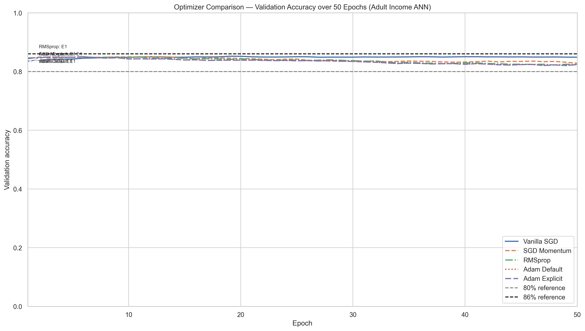

🎯 **Insight:** The graph compares validation accuracy across epochs and helps evaluate optimizer convergence speed and stability.

## Task 7.3 — Optimizer Comparison

| Optimizer | Main Characteristic |
|---|---|
| SGD | Uses gradient-based parameter updates |
| SGD Momentum | Uses accumulated gradient direction |
| RMSprop | Adapts learning rates using recent squared gradients |
| Adam | Combines momentum and adaptive learning rates |

🎯 **Insight:** Different optimizers can produce different convergence patterns. The final choice should be based on experimental validation results.

## Task 7.4 — Learning Rate Sensitivity

The experiment compares different learning rates for SGD and Adam.

**SGD learning rates:**

- 0.0001
- 0.001
- 0.01
- 0.1

**Adam learning rates:**

- 0.0001
- 0.001
- 0.01

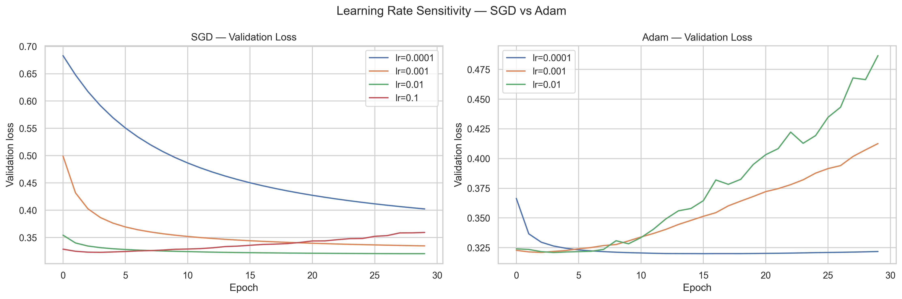

🎯 **Insight:** A learning rate that is too high can make training unstable, while a very low learning rate can slow down convergence.

## Task 7.5 — Final Combined ANN Model

The final model combines the selected architecture and training techniques:

- Hidden activation: ReLU
- Weight initializer: He Normal
- Batch Normalization: Enabled
- Optimizer: Adam
- Output activation: Sigmoid
- Epochs: 80
- Batch size: 64

The notebook uses class weighting for the final model when Weighted BCE improves class-1 F1 compared with baseline BCE.

### Python Code

```python
final_model = build_ann(
    input_dim=X_train.shape[1],
    hidden_units=(128, 64),
    activation="relu",
    initializer="he_normal",
    use_batch_norm=True,
    optimizer="adam",
    loss="binary_crossentropy"
)

final_fit_kwargs = {}

if use_weighted_final:
    final_fit_kwargs["class_weight"] = class_weight_dict

history_final = final_model.fit(
    X_train,
    y_train,
    epochs=80,
    batch_size=64,
    validation_split=0.1,
    verbose=1,
    **final_fit_kwargs
)
```

🎯 **Insight:** The final model combines the selected techniques and is evaluated on the same held-out test set used for the other model comparisons.

## Task 7.6 — Final Model Evaluation

The final model is evaluated using:

- Accuracy
- Precision
- Recall
- F1-Score
- ROC-AUC
- Confusion Matrix
- ROC Curve

### Python Code

```python
from sklearn.metrics import (
    accuracy_score,
    precision_score,
    recall_score,
    f1_score,
    roc_auc_score,
    classification_report
)

final_prob = final_model.predict(
    X_test,
    verbose=0
).ravel()

final_pred = (
    final_prob >= 0.5
).astype(int)

print("Accuracy:",
      accuracy_score(y_test, final_pred))

print("Precision:",
      precision_score(y_test, final_pred))

print("Recall:",
      recall_score(y_test, final_pred))

print("F1-Score:",
      f1_score(y_test, final_pred))

print("ROC-AUC:",
      roc_auc_score(y_test, final_prob))

print("\nClassification Report:")
print(
    classification_report(
        y_test,
        final_pred,
        target_names=["<=50K (0)", ">50K (1)"]
    )
)
```

### ROC Curve Comparison

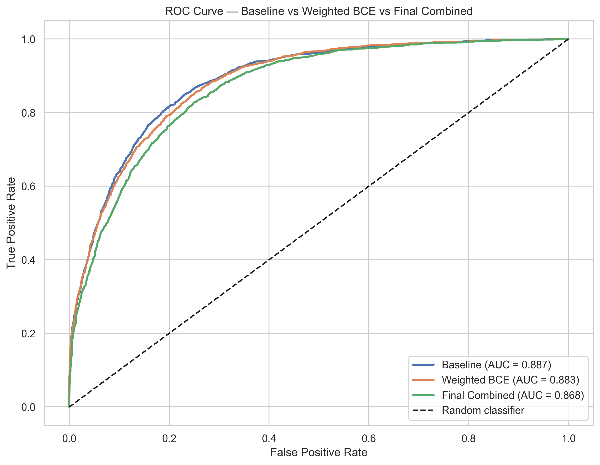

🎯 **Insight:** The ROC curve compares the true-positive rate and false-positive rate at different classification thresholds. A higher ROC-AUC indicates better ranking ability across thresholds.

---

# 🏆 Final Results & Model Comparison

The following values are taken from the notebook's final test-set comparison table.

| Model | Test Accuracy | Precision (1) | Recall (1) | F1 (1) | ROC-AUC |
|---|---:|---:|---:|---:|---:|
| Baseline ANN | 83.67% | 70.78% | 58.12% | 63.83% | 88.71% |
| Best Activation (Sigmoid) | **85.31%** | **75.01%** | 61.06% | **67.32%** | **91.19%** |
| Best Initializer (Glorot Uniform) | 83.67% | 70.78% | 58.12% | 63.83% | 88.71% |
| Weighted BCE | 79.78% | 56.56% | **79.39%** | 66.06% | 88.35% |
| Focal Loss | 81.90% | 75.36% | 40.10% | 52.34% | 87.52% |
| Batch Normalization | 81.19% | 65.36% | 51.34% | 57.51% | 86.13% |
| Final Combined ANN | 81.96% | 65.08% | 58.70% | 61.73% | 86.78% |

**Important observations:**

1. The Best Activation model achieved the highest test accuracy (85.31%), class-1 F1-score (67.32%), and ROC-AUC (91.19%) in this comparison.
2. Weighted BCE achieved the highest class-1 recall (79.39%), but its accuracy was lower than the baseline.
3. Focal Loss achieved higher precision than the baseline but lower class-1 recall and F1.
4. Batch Normalization did not improve the final test metrics over the baseline in this experiment.
5. The Final Combined model did not outperform the Best Activation model on the reported test metrics.

🎯 **Overall Insight:** This project demonstrates why model selection should consider multiple evaluation metrics. Accuracy, minority-class recall, F1-score, and ROC-AUC describe different aspects of classification performance.

---

# 📌 Key Learnings

Through this project, I learned:

- How to clean and preprocess a real-world tabular dataset.
- How to handle missing values and encode categorical features.
- How to build an ANN using TensorFlow and Keras.
- How activation functions affect neural network learning.
- Why suitable weight initialization is important.
- How different loss functions handle class imbalance.
- How Batch Normalization works.
- How optimizers and learning rates influence convergence.
- How to evaluate classification models using multiple metrics.
- Why test-set performance should guide model comparison.

# ⚠️ Limitations

- The project uses a single train-test split for the reported final comparison.
- Model performance depends on preprocessing, architecture, hyperparameters, and the classification threshold.
- Class imbalance affects the interpretation of accuracy.
- The model is an educational experiment and is not intended to make real-world income or employment decisions.

# 💻 Installation & Setup

## 1. Clone the Repository

```bash
git clone https://github.com/dhorajiyamisri/Deep-Learning-PR2-Adult-Income-Classification.git
```

## 2. Open the Project Folder

```bash
cd Deep-Learning-PR2-Adult-Income-Classification
```

## 3. Create a Virtual Environment (Optional)

```bash
python -m venv venv
```

Activate it on Windows:

```bash
venv\Scripts\activate
```

## 4. Install Required Libraries

```bash
pip install -r requirements.txt
```

## 5. Launch Jupyter Notebook

```bash
jupyter notebook
```

Open `DL_PR2.ipynb` and run the cells in order.

**Note:** Keep `adult.csv` in the same project folder as the notebook. The notebook saves generated visualizations in the `Project_Graphs/` directory.

---

# 🔮 Future Improvements

- Hyperparameter tuning with Keras Tuner.
- Experiment with different classification thresholds.
- Perform cross-validation for more robust evaluation.
- Compare ANN with traditional machine learning models.
- Explore additional techniques for handling class imbalance.
- Build a simple interface for testing predictions.

---

## 👩‍💻 Author

**Misari Dhorajiya**

- GitHub: [dhorajiyamisri](https://github.com/dhorajiyamisri)
- Project Repository: [Deep Learning PR2 — Adult Income Classification](https://github.com/dhorajiyamisri/Deep-Learning-PR2-Adult-Income-Classification)

---

## 🙏 Thank You

Thank you for visiting this project!

This project helped me understand the practical implementation of Artificial Neural Networks and the impact of different deep learning techniques on binary classification performance.

If you find this project useful, feel free to explore the notebook and its experiments.
